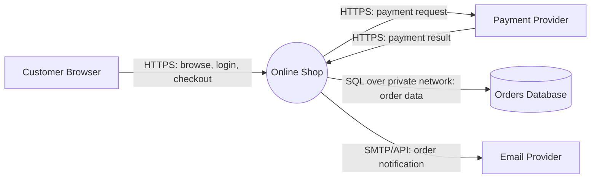
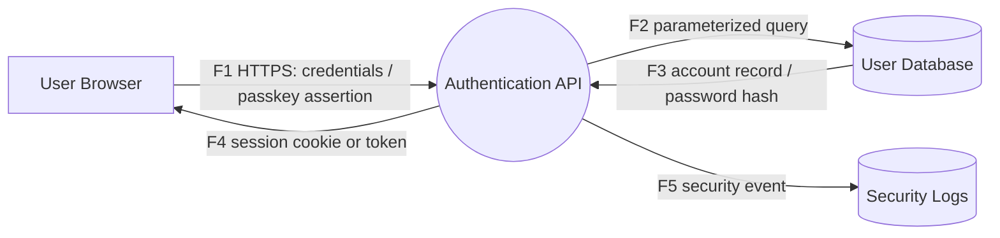
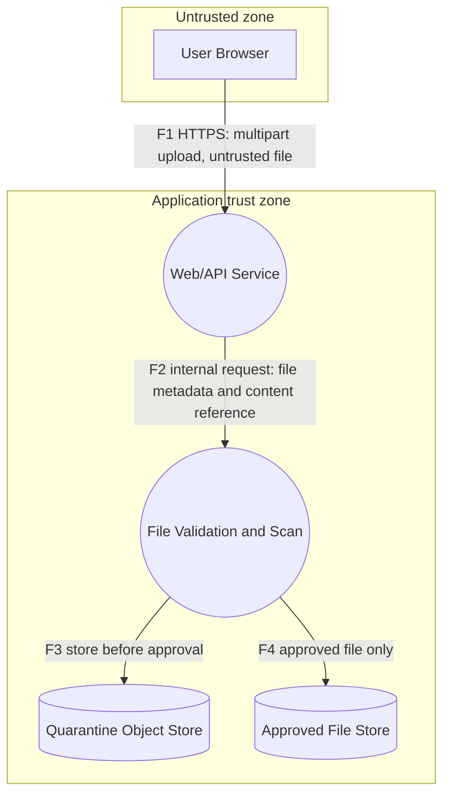
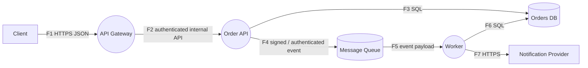
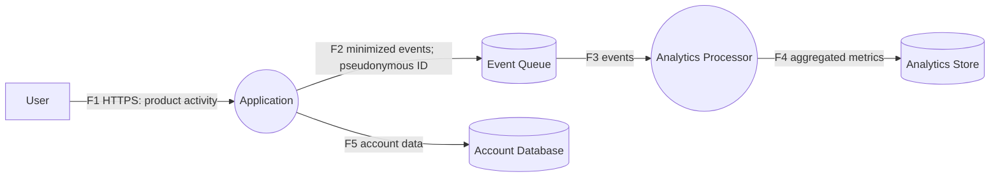

# Data Flow Diagram Examples

These examples are simplified learning models. Adapt them to the actual system and document assumptions.

## Example 1: Context diagram — online shop

**Discussion**
- The browser and external providers are outside the shop's direct control.
- The database should not be publicly reachable.
- Payment data should be minimized; avoid storing card security codes.
- The diagram is a context-level view; it intentionally hides internal app processes.

## Example 2: Level 1 DFD — login workflow

**Security questions**
- Is authentication enforced on every protected endpoint?
- Are passwords stored using a modern password-hashing scheme?
- Are session cookies configured securely and tokens handled safely?
- Do logs exclude passwords, tokens, and other secrets?
- Are login attempts rate-limited and suspicious patterns monitored?

## Example 3: File upload with a trust boundary

**Security questions**
- Are size, extension, content type, and file signature validated?
- Is the file stored outside executable web roots?
- Are filenames generated by the server?
- Does the scanning process run with least privilege?
- Can a user retrieve a quarantined file?
- Are archives checked for decompression bombs and path traversal?

## Example 4: API, queue, worker, and database

**Security questions**
- Does the gateway validate requests and enforce rate limits?
- Does the service independently authenticate and authorize calls?
- Are queue producers/consumers authorized separately?
- Are events schema-validated and protected against replay where needed?
- Are sensitive fields minimized in events and logs?
- Are retries bounded and dead-letter queues access-controlled?

## Example 5: Privacy-aware analytics flow

**Security and privacy questions**
- Is analytics collection necessary and disclosed?
- Can direct identifiers be removed or pseudonymized?
- Are retention periods defined?
- Are access controls and deletion workflows available?
- Could events contain secrets or free-text personal data?

## Example 6: Flow inventory example

| Flow ID | Source → destination | Data | Protocol | Trust consideration |
|---|---|---|---|---|
| F1 | Browser → API | Login request | HTTPS | Treat client input as untrusted |
| F2 | API → database | User lookup | Private DB protocol | Least privilege; parameterized query |
| F3 | API → queue | Order event | Authenticated TLS connection | Validate schema; minimize fields |
| F4 | Worker → provider | Notification request | HTTPS | Protect API credentials; limit data |

## Practice: annotate the diagram
For each example, mark:
1. All external entities.
2. All processes and stores.
3. Every trust-boundary crossing.
4. Sensitive data and the protection needed in transit and at rest.
5. At least two plausible threats and corresponding mitigations.
