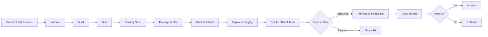

# 02 — Pipeline Architecture

Learn how to design a maintainable, reliable, and secure CI/CD pipeline from source control through deployment and verification.

## Learning objectives

By the end of this module, you should be able to:

- Explain CI, continuous delivery, and continuous deployment.
- Identify pipeline stages, jobs, steps, runners, artifacts, caches, and dependencies.
- Design a pipeline with clear stage boundaries and failure behavior.
- Distinguish build-time checks from deployment-time verification.
- Add security checks and quality gates at appropriate points.
- Separate development, staging, and production environments.
- Explain rollback, artifact promotion, and deployment strategies.
- Read and adapt a basic GitHub Actions workflow.

## Prerequisites

- Basic Git and command-line knowledge.
- Familiarity with a programming language and automated tests.
- GitHub account for the optional GitHub Actions lab.
- A repository containing a small application or sample files.

## Core concepts

| Concept | Meaning |
|---|---|
| Pipeline | Automated sequence of activities that moves a change toward release. |
| Stage | Logical phase such as build, test, scan, package, or deploy. |
| Job | A unit of work scheduled by the CI/CD platform. |
| Step | An individual command or action inside a job. |
| Runner/agent | Machine or execution environment that runs a job. |
| Artifact | Output retained from a pipeline run, such as a package, test report, or image. |
| Cache | Reusable data intended to speed up later runs; it is not a release artifact. |
| Quality gate | Rule that must pass before the pipeline proceeds. |
| Environment | Deployment target such as development, staging, or production. |
| Promotion | Moving the same tested artifact between environments instead of rebuilding it. |

## CI, continuous delivery, and continuous deployment

- **Continuous integration (CI):** Frequently integrate changes and automatically build and test them.
- **Continuous delivery:** Keep the application in a releasable state; production release may require approval.
- **Continuous deployment:** Automatically release every change that passes the required checks to production.

Continuous deployment is not automatically the best choice for every organization. Risk, regulation, and business requirements determine the appropriate release controls.

## Reference architecture



## Recommended stage design

1. **Trigger and validate:** Run on pull requests and pushes to appropriate branches. Validate the event and source revision.
2. **Build:** Resolve pinned dependencies and compile/package the application.
3. **Test:** Run unit, integration, and contract tests. Publish test results.
4. **Security checks:** Scan secrets, source code, dependencies, infrastructure definitions, and container images where relevant.
5. **Package:** Create a versioned artifact. Record its checksum and build metadata.
6. **Publish:** Upload the artifact to a controlled registry or artifact repository.
7. **Deploy to a lower environment:** Deploy the exact artifact that passed validation.
8. **Verify:** Run smoke tests, health checks, and appropriate dynamic security tests.
9. **Release gate:** Use automated policy and, where required, an authorized human approval.
10. **Promote and monitor:** Promote the same artifact, verify service health, monitor, and roll back if defined criteria are breached.

## Pipeline design principles

- Keep jobs small and give each job a clear purpose.
- Express dependencies explicitly; avoid accidental reliance on execution order.
- Fail fast on essential build, test, and security gates.
- Keep secrets out of source code, logs, command-line output, and build artifacts.
- Use least-privilege identities and short-lived credentials where possible.
- Protect pipeline configuration with review and ownership rules.
- Pin third-party CI actions to immutable commit SHAs in production workflows.
- Separate build permissions from deployment permissions.
- Do not treat a cache as a trusted artifact.
- Promote an immutable artifact between environments rather than rebuilding it.
- Define health checks, deployment timeouts, and rollback criteria before release.
- Retain useful logs, test reports, scan results, and artifact provenance.

## Common pipeline patterns

### Sequential pipeline

Stages run in order. This is easy to understand but can be slower.

### Parallel jobs

Independent checks, such as unit tests and static analysis, can run concurrently after source validation. This reduces elapsed time but requires clear dependencies and resource planning.

### Artifact promotion

Build once, test the artifact, then promote that exact artifact to staging and production. This reduces differences between environments.

### Deployment strategies

- **Rolling:** Replace instances gradually.
- **Blue/green:** Switch traffic between two environments.
- **Canary:** Send a small portion of traffic to the new version and increase it after successful checks.
- **Feature flags:** Deploy code while controlling feature exposure separately.

## Security controls by stage

| Stage | Example controls |
|---|---|
| Source / PR | Protected branches, review, secret scanning, linting |
| Build | Pinned dependencies, isolated runner, minimal permissions |
| Test | Unit and integration tests, coverage thresholds |
| Security | SAST, SCA, IaC scanning, container scanning |
| Package | Versioning, checksum, SBOM, signing/provenance when supported |
| Publish | Restricted write permissions, immutable tags or digests |
| Deploy | Separate deployment identity, environment protection, approval |
| Verify / operate | Smoke tests, runtime monitoring, audit logs, rollback |

Security checks should be proportionate to the application and risk. A finding should have a documented severity policy, owner, and exception process rather than being silently ignored.

## Suggested repository layout

```text
02-Pipeline-Architecture/
├── README.md
├── examples.md
├── practical.md
└── solutions.md
```

## Hands-on workflow

1. Read the pipeline concepts and inspect the architecture diagram.
2. Review the sample workflow in `examples.md`.
3. Complete the exercises in `practical.md` without opening `solutions.md`.
4. Compare your design with `solutions.md`.
5. Adapt the workflow to a test repository and observe what happens when a stage fails.

## Knowledge check

1. What is the difference between a pipeline stage, job, and step?
2. Why is a cache different from an artifact?
3. Why should production deploy permissions be separated from build permissions?
4. What is the benefit of promoting the same artifact?
5. Which checks should block a release, and who can approve exceptions?
6. What signals should trigger a rollback?

## Further reading

- [GitHub Actions workflow syntax](https://docs.github.com/en/actions/reference/workflows-and-actions/workflow-syntax)
- [GitHub Actions jobs and dependencies](https://docs.github.com/en/actions/how-tos/write-workflows/choose-what-workflows-do/use-jobs)
- [Store and share workflow artifacts](https://docs.github.com/en/actions/tutorials/store-and-share-data)
- [OWASP DevSecOps Guideline](https://owasp.org/www-project-devsecops-guideline/)
- [Google SRE — Release Engineering](https://sre.google/sre-book/release-engineering/)

## Completion checklist

- [ ] I can explain CI, continuous delivery, and continuous deployment.
- [ ] I can sketch a pipeline from commit to production.
- [ ] I can identify artifact, cache, runner, and environment boundaries.
- [ ] I can place quality and security gates appropriately.
- [ ] I can explain artifact promotion and rollback.
- [ ] I completed at least three practical exercises.
