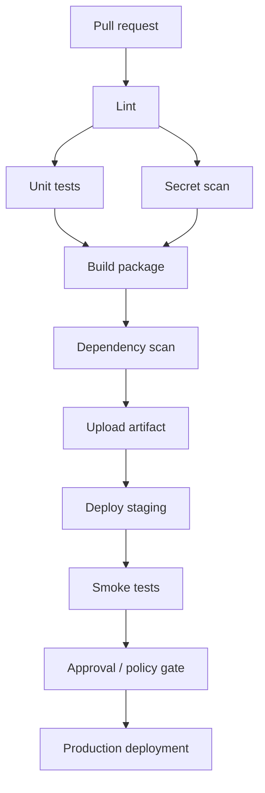
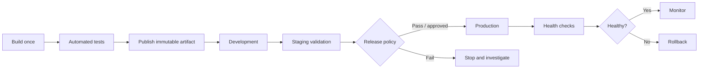

# Examples — Pipeline Architecture

These examples are educational starting points. Adapt runtime versions, dependencies, permissions, and deployment steps to your application. Do not place production credentials in repository files.

## Example 1: A simple pipeline map



Linting and unit tests can run in parallel when they do not depend on each other's output. Packaging must wait for the required checks.

## Example 2: A simple GitHub Actions Python CI workflow

Save as `.github/workflows/ci.yml` in a test repository. It runs on pull requests and pushes to `main`, uses read-only repository permissions, installs dependencies, runs tests, and uploads a test report if one is produced.

```yaml
name: CI Pipeline

on:
  pull_request:
  push:
    branches: [main]

permissions:
  contents: read

jobs:
  test:
    name: Test application
    runs-on: ubuntu-latest
    steps:
      - name: Check out source
        uses: actions/checkout@v4

      - name: Set up Python
        uses: actions/setup-python@v5
        with:
          python-version: "3.12"
          cache: pip

      - name: Install dependencies
        run: |
          python -m pip install --upgrade pip
          if [ -f requirements.txt ]; then pip install -r requirements.txt; fi
          pip install pytest

      - name: Run tests
        run: pytest -q --junitxml=test-results.xml

      - name: Upload test report
        if: always()
        uses: actions/upload-artifact@v4
        with:
          name: test-results
          path: test-results.xml
          if-no-files-found: ignore
```

**Important hardening note:** The version tags above make the example readable, but a hardened production workflow should pin third-party actions to verified full commit SHAs and update them through a controlled process. Also review the permissions and runner trust model for your repository.

## Example 3: Explicit stage dependencies

```yaml
name: Staged CI

on:
  pull_request:
  push:
    branches: [main]

permissions:
  contents: read

jobs:
  lint:
    runs-on: ubuntu-latest
    steps:
      - uses: actions/checkout@v4
      - name: Check whitespace
        run: git diff --check

  test:
    runs-on: ubuntu-latest
    steps:
      - uses: actions/checkout@v4
      - name: Basic validation
        run: |
          python --version
          test -f README.md

  package:
    needs: [lint, test]
    runs-on: ubuntu-latest
    steps:
      - uses: actions/checkout@v4
      - name: Create a source archive
        run: |
          mkdir -p dist
          git archive --format=tar.gz --output=dist/source.tar.gz HEAD
      - name: Upload package
        uses: actions/upload-artifact@v4
        with:
          name: source-package
          path: dist/source.tar.gz
```

The `needs` field expresses a dependency. The package job is skipped when a required upstream job fails or is skipped.

## Example 4: Build once, promote the artifact

A release process should identify the artifact by a version and preferably a cryptographic digest.

```text
Commit: 7ac91f2
   |
   v
Build artifact: app-1.4.0.tar.gz
   |
   +--> SHA-256: <calculated digest>
   |
   v
Test exact artifact
   |
   v
Publish to controlled artifact repository
   |
   v
Deploy same artifact to staging
   |
   v
Smoke / security checks
   |
   v
Approved promotion of same artifact to production
```

Do not copy the placeholder digest as if it were real. Calculate a checksum for the actual artifact, for example:

```bash
sha256sum dist/app-1.4.0.tar.gz
```

On PowerShell:

```powershell
Get-FileHash .\dist\app-1.4.0.tar.gz -Algorithm SHA256
```

A checksum helps detect accidental or unauthorized changes when compared against a trusted value. It does not by itself prove who built the artifact.

## Example 5: Environment promotion model



Keep environment-specific configuration outside the compiled artifact where possible. Secrets should be supplied securely at runtime.

## Example 6: Quality-gate policy

A simple release policy can be expressed as a checklist:

```text
RELEASE_ALLOWED =
    build_passed
    AND required_tests_passed
    AND no_unapproved_critical_vulnerabilities
    AND artifact_integrity_verified
    AND required_approval_present
```

This is conceptual pseudocode, not an executable policy engine. Define what counts as “critical,” how exceptions expire, and who can approve them.

## Example 7: Pipeline failure behavior

| Failure | Recommended behavior |
|---|---|
| Build fails | Stop; publish logs for diagnosis. |
| Required unit test fails | Block packaging or release. |
| Secret detected | Block merge/release; revoke and rotate exposed credentials. |
| Critical vulnerability found | Block release according to policy; document any approved exception. |
| Staging smoke test fails | Do not promote to production. |
| Production health check fails | Alert and invoke the tested rollback or mitigation procedure. |
| Optional report upload fails | Decide explicitly whether this is informational or release-blocking. |

## Example 8: Basic pipeline timing exercise

Suppose these tasks take the following times:

- Lint: 2 minutes
- Unit tests: 5 minutes
- Secret scan: 3 minutes
- Package: 2 minutes

If lint, unit tests, and secret scanning run in parallel, then packaging waits for all three. Ignoring queue time and overhead, expected duration is approximately:

`max(2, 5, 3) + 2 = 7 minutes`

If all tasks run sequentially, duration is:

`2 + 5 + 3 + 2 = 12 minutes`

Parallelism reduces elapsed time, but uses more concurrent runner capacity.
