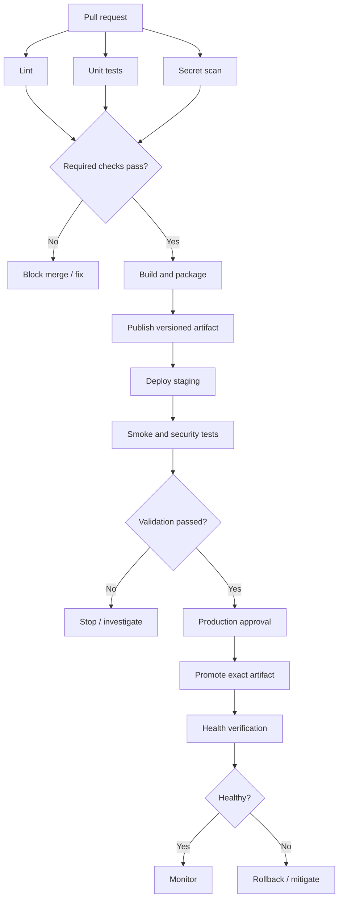

# Solutions — Pipeline Architecture

Use these as model answers. There can be more than one valid design; justify choices based on risk, delivery requirements, and operational constraints.

## Solution 1 — Basic pipeline design



Independent checks can run in parallel. Packaging waits for required checks, and production waits for staging validation and the required release gate.

## Solution 2 — Component classification

1. **Linux VM:** Runner.
2. **`pytest` command:** Step.
3. **Compressed application package:** Artifact.
4. **Tests must pass before merge:** Quality gate.
5. **Staging server group:** Environment.
6. **Dependency scanner job:** Job; it may be part of a security stage.
7. **Reused downloaded package data:** Cache.
8. **Logical Test phase:** Stage.

A pipeline platform may use different names, but the distinction between reusable cache data and a versioned deliverable remains important.

## Solution 3 — Basic GitHub Actions workflow

Example `.github/workflows/ci.yml`:

```yaml
name: Python CI

on:
  pull_request:
  push:
    branches: [main]

permissions:
  contents: read

jobs:
  test:
    runs-on: ubuntu-latest
    steps:
      - name: Check out source
        uses: actions/checkout@v4

      - name: Set up Python
        uses: actions/setup-python@v5
        with:
          python-version: "3.12"

      - name: Install test dependency
        run: |
          python -m pip install --upgrade pip
          python -m pip install pytest

      - name: Run tests
        run: python -m pytest -q
```

This assumes the tests need only `pytest`. Install the application's pinned dependencies too when the project requires them. In a hardened production workflow, pin third-party actions to verified full commit SHAs and update those pins through a controlled process.

A passing test run should finish successfully. A deliberately failing assertion should cause `pytest` and the job to return a non-zero exit status.

## Solution 4 — Job dependencies

```yaml
jobs:
  lint:
    runs-on: ubuntu-latest
    steps:
      - uses: actions/checkout@v4
      - run: git diff --check

  test:
    runs-on: ubuntu-latest
    steps:
      - uses: actions/checkout@v4
      - run: python --version

  package:
    needs: [lint, test]
    runs-on: ubuntu-latest
    steps:
      - uses: actions/checkout@v4
      - run: |
          mkdir -p dist
          git archive --format=tar.gz --output=dist/source.tar.gz HEAD
```

If either required job fails, `package` does not run under the default success behavior. Explicit dependencies make the intended graph clear and allow independent jobs to run concurrently.

## Solution 5 — Security gate model

| Check | Pipeline stage | Example blocking condition | Exception owner |
|---|---|---|---|
| Secret scanning | PR/source | Confirmed credential exposure | Security owner; credential must also be revoked/rotated |
| SAST | PR/build | New high-confidence critical/high issue under policy | Application security owner |
| SCA | Build/package | Vulnerable dependency above approved severity or exploitability threshold | Product security and service owner |
| IaC scan | PR/infra build | Public exposure or privilege configuration prohibited by policy | Cloud/platform security owner |
| Container scan | Package/release | Image violates vulnerability or configuration policy | Container/platform security owner |

Define severity, exploitability, false-positive handling, exception expiry, and remediation ownership. Never treat a detected secret as resolved merely because a scan result was dismissed.

## Solution 6 — Artifact promotion

1. Build once from a reviewed commit.
2. Assign a unique version, such as `api-1.4.0+<commit>`.
3. Calculate a checksum or use a registry digest.
4. Publish to an access-controlled artifact repository.
5. Test that artifact and deploy it to staging.
6. Record staging results and the artifact digest.
7. Require any applicable release approval.
8. Deploy the exact artifact identified by that digest to production.
9. Record the release identity, approval, environment, timestamp, and result.

Rebuilding can change dependencies, build-time inputs, timestamps, or generated content. A staging test then no longer proves that the independently rebuilt production artifact is identical. A checksum helps compare bytes, while provenance and signing can provide additional evidence about origin and build process.

## Solution 7 — Pipeline duration

**Sequential execution**

`2 + 5 + 3 + 2 + 4 = 16 minutes`

**Parallel first three tasks**

- Parallel group: `max(2, 5, 3) = 5 minutes`
- Package: `2 minutes`
- Smoke test: `4 minutes`

Total: `5 + 2 + 4 = 11 minutes`

These estimates ignore runner queue time, environment deployment time, and overhead.

## Solution 8 — Deployment strategies

1. **Low-risk internal service with identical instances:** Rolling deployment is often a reasonable, low-complexity choice.
2. **High-traffic public service needing gradual observation:** Canary deployment limits initial exposure and allows metrics-based expansion.
3. **Fast traffic switch back:** Blue/green can support a rapid switch if both environments remain ready and data compatibility is managed.
4. **Deploy now, enable for selected users later:** Feature flags separate deployment from feature exposure.

The correct choice depends on stateful behavior, database compatibility, infrastructure cost, observability, and operational readiness.

## Solution 9 — Rollback plan

A model plan:

1. Monitor error rate, latency, availability, and relevant business metrics.
2. Set a service-specific threshold and observation window before release.
3. If the threshold is breached, alert the on-call owner and pause further rollout; use automatic rollback only when the criteria are reliable and tested.
4. Identify the previous known-good artifact by immutable version or digest.
5. Revert traffic or redeploy the previous artifact using the established deployment mechanism.
6. Check database compatibility. Prefer backward-compatible expand-and-contract migrations; do not assume a code rollback reverses schema or data changes.
7. Verify service health and confirm recovery.
8. Preserve deployment logs, metrics, the artifact digest, decision timestamps, and relevant audit records.
9. Communicate the incident and complete a blameless review with corrective actions.

## Solution 10 — Threat review

| Risk | Mitigation |
|---|---|
| Shared administrator credential | Use separate least-privilege identities for each job and environment. |
| Fork PR executes on persistent self-hosted runner | Use isolated ephemeral runners; do not expose trusted runner secrets to untrusted code. |
| Developers can alter production workflow without review | Protect branches, require review, and assign `CODEOWNERS` to workflow files. |
| Build job has production credentials | Separate build and deploy jobs/identities; use environment protections and short-lived credentials. |
| Mutable third-party action tags | Pin actions to verified full commit SHAs and update them deliberately. |
| Artifact rebuilt for each environment | Build once, publish immutably, and promote the same artifact. |
| Logs deleted immediately | Retain access-controlled, tamper-resistant logs and audit evidence for a defined period. |

Additional mitigations may include restricted workflow permissions, dependency pinning, secret scanning, network egress controls, artifact attestations, and monitoring for unusual pipeline activity.

## Solution 11 — Example failure matrix

| Failure | Expected status / later jobs | Evidence | Recovery |
|---|---|---|---|
| Build failure | Fail; do not run dependent jobs | Build log, commit, tool versions | Fix build and rerun |
| Required test failure | Fail; block release | Test output and report | Fix defect; rerun tests |
| Secret detected | Block merge/release | Finding metadata without printing the secret | Revoke/rotate credential, remove exposure, investigate |
| Staging smoke test failure | Block promotion | Deployment version, health logs, test output | Diagnose and redeploy/fix |
| Production health threshold breached | Pause rollout; rollback or mitigate | Metrics, logs, release ID, timestamps | Restore known-good service and verify |
| Optional report upload fails | Follow documented policy; may remain non-blocking | Upload error and job status | Retry or fix reporting integration |

Whether a report upload is blocking should be decided explicitly. Required evidence should not be silently discarded.

## Solution 12 — Mini-project acceptance criteria

A strong submission should include:

- A readable pipeline diagram with triggers, jobs, dependencies, and release gates.
- Automated tests and clear failure behavior.
- Secret scanning and appropriate SAST/SCA/IaC/container checks.
- Least-privilege workflow permissions and secure secret handling.
- Versioned artifact publication and integrity verification.
- Staging validation and production environment protection.
- A defined rollback process with database considerations.
- Logs and evidence sufficient for troubleshooting and audit.
- A short threat review that addresses untrusted contributions and pipeline tampering.

## Final review checklist

- [ ] Stage order and dependencies are explicit.
- [ ] Required failures block downstream release jobs.
- [ ] Parallelism is used only for independent tasks.
- [ ] Artifact and cache are not confused.
- [ ] Production deploy access is restricted.
- [ ] Artifact promotion is traceable and immutable where supported.
- [ ] Security exceptions have an owner, rationale, and expiry.
- [ ] Health checks and rollback are tested, not merely documented.
