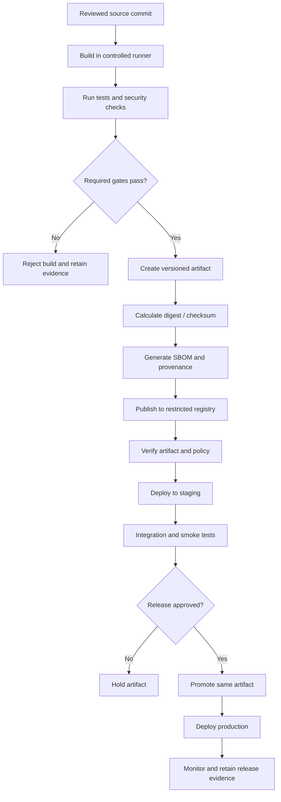

# 04 — Artifacts and Registries

Learn how CI/CD artifacts are created, versioned, stored, verified, promoted, and governed across software delivery environments.

## Learning objectives

By completing this module, you should be able to:

- Explain the difference between build artifacts, container images, packages, caches, and source code.
- Identify common artifact and container registries.
- Version artifacts and make releases traceable to source commits.
- Use checksums and digests to verify artifact integrity.
- Explain immutable artifacts and promotion between environments.
- Apply access control, retention, scanning, signing, and provenance practices.
- Design a secure artifact lifecycle for a CI/CD pipeline.

## Prerequisites

- Basic Git and CI/CD concepts.
- Familiarity with command-line tools.
- Docker knowledge is useful for the container registry examples.
- Use a personal test repository and non-production registry for hands-on work.

## Core concepts

| Term | Description |
|---|---|
| Artifact | A file or package produced or consumed by a build, such as a ZIP, JAR, wheel, binary, or test report. |
| Package registry | Service that stores versioned packages, such as Python packages or JavaScript packages. |
| Container registry | Service that stores and distributes container images. |
| Repository | A logical namespace or collection in a registry. |
| Tag | A human-readable label that can point to an image or release. Tags may be mutable unless the registry enforces immutability. |
| Digest | Content-derived identifier, commonly a SHA-256 digest for container images. |
| Checksum | A hash calculated over bytes to detect unexpected changes. |
| SBOM | Software Bill of Materials: a structured inventory of software components and dependencies. |
| Provenance | Evidence about where, how, and from which source an artifact was built. |
| Attestation | A statement with associated evidence about an artifact or build, ideally verifiable and bound to the artifact. |
| Retention policy | Rules for how long artifacts and metadata are stored. |
| Promotion | Moving or authorizing the same tested artifact for use in another environment. |

## Artifact lifecycle



## Common artifact types

- **Application packages:** `.zip`, `.tar.gz`, `.jar`, `.war`, `.whl`, `.tgz`.
- **Container images:** OCI-compatible images distributed by container registries.
- **Frontend bundles:** Compiled JavaScript, CSS, fonts, and static assets.
- **Infrastructure artifacts:** Versioned modules, plans, charts, or deployment bundles, depending on the tool.
- **Build evidence:** Test reports, scan reports, SBOMs, signatures, and provenance attestations.

Build evidence is valuable, but it should be stored and protected according to its sensitivity. Reports may reveal file paths, dependency versions, internal hostnames, or other operational details.

## Registries and examples

| Registry type | Typical use | Examples |
|---|---|---|
| Container registry | OCI/Docker images | GitHub Container Registry (GHCR), Docker Hub, Amazon ECR, Azure Container Registry, Google Artifact Registry |
| Language package registry | Libraries and packages | PyPI, npm registry, Maven repositories, NuGet feeds |
| General artifact repository | Build outputs and release bundles | JFrog Artifactory, Sonatype Nexus Repository, platform-native artifact stores |
| CI run artifact storage | Temporary or per-run reports and bundles | GitHub Actions artifacts, GitLab job artifacts |

Choose a registry based on access controls, supported formats, immutability, replication, auditability, retention, vulnerability scanning, and integration with your delivery platform.

## Versioning strategy

A useful artifact identifier answers:

- Which application and release is this?
- Which source revision produced it?
- Which build or workflow produced it?
- Can the artifact be fetched again without ambiguity?

Examples:

```text
web-api:1.8.2
web-api:1.8.2-rc.3
web-api:git-7ac91f2
web-api@sha256:<actual-image-digest>
```

A semantic version such as `1.8.2` communicates release intent. A commit identifier improves source traceability. A digest identifies content. A tag alone may be moved unless immutability is enforced; use a digest when an exact container image is required.

## Integrity, authenticity, and provenance

These controls solve related but different problems:

- **Checksum/digest:** Detects whether content differs from the expected content. The expected value must come from a trusted source.
- **Signature:** Can help verify that an artifact or statement was signed by a trusted identity.
- **Provenance:** Describes the source and process used to build an artifact.
- **SBOM:** Lists software components and can support vulnerability and license analysis.
- **Access control and audit logs:** Restrict who can publish, replace, delete, or promote artifacts and record relevant actions.

A checksum alone does not prove who created an artifact. A signature is only as trustworthy as the key or identity and verification policy. Provenance should be authenticated and checked against policy.

## Recommended security controls

1. Restrict write access to registry repositories; developers who can read packages may not need publish rights.
2. Use separate identities for CI publishing and production deployment.
3. Prefer short-lived credentials or workload identity federation over long-lived registry passwords.
4. Store release artifacts immutably where supported; protect release tags from overwrite.
5. Deploy images by digest or verify that a release tag resolves to the approved digest.
6. Scan dependencies and container images at build/publish time, and rescan when new vulnerability data becomes available.
7. Generate an SBOM for release artifacts where practical.
8. Verify signatures and provenance before promotion or deployment.
9. Use retention and cleanup rules that preserve released artifacts and required audit evidence.
10. Avoid publishing secrets, `.env` files, private keys, local configuration, or unnecessary build directories.
11. Keep registries private unless public distribution is intentional.
12. Record the artifact digest in deployment records so an incident can be traced to the exact deployed content.

## Artifact promotion

**Recommended pattern:** Build once, test that artifact, and promote the exact same artifact through development, staging, and production.

```text
Source commit
   |
   v
Build artifact once
   |
   v
Test + scan + SBOM + provenance
   |
   v
Publish immutable version / digest
   |
   v
Deploy exact digest to staging
   |
   v
Validate and approve
   |
   v
Deploy same digest to production
```

Rebuilding for each environment can produce different bytes because of dependency drift, build-time configuration, timestamps, or toolchain changes. Keep environment-specific configuration outside the artifact where possible and inject it securely at deployment time.

## Retention and cleanup

Retention policies should distinguish between:

- Temporary pull-request or branch builds.
- Nightly and development artifacts.
- Release candidates.
- Production releases and artifacts needed for rollback.
- Compliance, incident response, and audit evidence.

Do not delete an artifact that is still deployed or required for a supported rollback. Define retention periods, legal or regulatory constraints, storage costs, and restoration procedures.

## Suggested directory structure

```text
04-Artifacts-and-Registries/
├── README.md
├── examples.md
├── practical.md
└── solutions.md
```

## Knowledge check

1. How does a digest differ from a tag?
2. Why is a checksum not sufficient proof of publisher identity?
3. What is the difference between an SBOM and provenance?
4. Why should CI publishing permissions differ from deployment permissions?
5. Why is promoting an artifact safer than rebuilding it for each environment?
6. What should a retention policy protect?

## Further reading

- [GitHub Packages documentation](https://docs.github.com/en/packages)
- [GitHub Container Registry](https://docs.github.com/en/packages/working-with-a-github-packages-registry/working-with-the-container-registry)
- [Docker image digests](https://docs.docker.com/dhi/core-concepts/digests/)
- [OCI Distribution Specification](https://github.com/opencontainers/distribution-spec)
- [SLSA — Supply-chain Levels for Software Artifacts](https://slsa.dev/)
- [SPDX specifications](https://spdx.dev/)
- [CycloneDX](https://cyclonedx.org/)

## Completion checklist

- [ ] I can distinguish artifacts, packages, container images, caches, and reports.
- [ ] I can explain version, tag, digest, checksum, SBOM, and provenance.
- [ ] I can publish and retrieve an artifact in a test environment.
- [ ] I can verify an artifact checksum or image digest.
- [ ] I can design a build-once promotion flow.
- [ ] I have documented access, retention, and rollback requirements.
