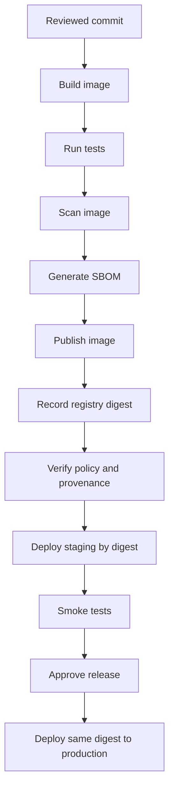

# Examples — Artifacts and Registries

Examples use local or test resources. Replace placeholders with your own repository and registry. Never paste access tokens into source files or commit them to Git.

## Example 1 — Create a versioned archive

Create a source archive from a Git commit:

```bash
mkdir -p dist
git archive --format=tar.gz --output=dist/source.tar.gz HEAD
```

Record the commit:

```bash
git rev-parse HEAD
```

Calculate the checksum on Linux:

```bash
sha256sum dist/source.tar.gz
```

On macOS:

```bash
shasum -a 256 dist/source.tar.gz
```

On PowerShell:

```powershell
Get-FileHash .\dist\source.tar.gz -Algorithm SHA256
```

Store the checksum in a release record or trusted build metadata. Do not treat a checksum downloaded from the same untrusted location as independent proof of authenticity.

## Example 2 — Compare a file against its expected checksum

Linux:

```bash
sha256sum dist/source.tar.gz
```

If you have a trusted checksum file named `SHA256SUMS`:

```bash
sha256sum --check SHA256SUMS
```

PowerShell:

```powershell
$actual = (Get-FileHash .\dist\source.tar.gz -Algorithm SHA256).Hash.ToLower()
$expected = "<trusted-sha256-hex>".ToLower()

if ($actual -ne $expected) {
    throw "Checksum mismatch"
}

Write-Output "Checksum verified"
```

Replace the placeholder with a real expected value from a trusted release record. Do not use the literal placeholder as a checksum.

## Example 3 — Build and tag a container image

From a directory containing a Dockerfile:

```bash
docker build -t my-web-api:1.0.0 .
docker image inspect my-web-api:1.0.0
```

Tag with a commit identifier:

```bash
GIT_SHA="$(git rev-parse --short=12 HEAD)"
docker build -t my-web-api:git-"$GIT_SHA" .
```

For PowerShell:

```powershell
$GitSha = (git rev-parse --short=12 HEAD).Trim()
docker build -t "my-web-api:git-$GitSha" .
```

Do not use `latest` as the sole release identifier. It is a convenient pointer but may move.

## Example 4 — Inspect an image digest

After pulling or pushing an image:

```bash
docker image ls --digests
docker image inspect --format='{{index .RepoDigests 0}}' my-web-api:1.0.0
```

The `RepoDigests` field may be empty for a locally built image that has not been pushed to a registry. After publishing, use the registry-reported digest or inspect the pulled image. Deploy by digest when you need to identify exact content:

```text
registry.example.com/team/my-web-api@sha256:<actual-digest>
```

The digest above is a placeholder, not a real image reference.

## Example 5 — Log in to a registry securely

Use the registry's official authentication instructions. Prefer a short-lived token or identity-based authentication and avoid passing secrets directly in shell history.

Example pattern for a compatible registry:

```bash
echo "$REGISTRY_TOKEN" | docker login ghcr.io \
  --username "$REGISTRY_USER" \
  --password-stdin
```

Set `REGISTRY_TOKEN` and `REGISTRY_USER` through your CI secret store or environment. Do not echo the token or commit it. Grant only the permissions needed to publish the target package.

## Example 6 — Push to GitHub Container Registry

Assuming the image is tagged and you have authenticated to GHCR with permission to publish:

```bash
docker tag my-web-api:1.0.0 ghcr.io/OWNER/my-web-api:1.0.0
docker push ghcr.io/OWNER/my-web-api:1.0.0
```

Replace `OWNER` with the GitHub user or organization that owns the package. Confirm package visibility and permissions in the registry. For repeatable deployment, record the digest returned after the push and use that digest downstream.

## Example 7 — GitHub Actions: upload a build artifact

This example uploads a generated archive for later jobs or download from a workflow run. It is a workflow artifact, not a permanent package registry release.

```yaml
name: Build Artifact

on:
  push:
    branches: [main]
  pull_request:

permissions:
  contents: read

jobs:
  package:
    runs-on: ubuntu-latest
    steps:
      - name: Check out source
        uses: actions/checkout@v4

      - name: Create source archive
        run: |
          mkdir -p dist
          git archive --format=tar.gz --output=dist/source.tar.gz HEAD
          sha256sum dist/source.tar.gz > dist/SHA256SUMS

      - name: Upload archive and checksum
        uses: actions/upload-artifact@v4
        with:
          name: source-package
          path: |
            dist/source.tar.gz
            dist/SHA256SUMS
          if-no-files-found: error
```

For production workflows, pin third-party actions to verified full commit SHAs and maintain those pins through a controlled update process. The archive above contains tracked source files, not a compiled application. Adapt the build step to your application.

## Example 8 — Container build and publish flow

Conceptual flow:



The exact commands for image scanning, SBOM generation, signing, and provenance depend on the tools and registry in use. Keep their output linked to the image digest.

## Example 9 — Artifact naming convention

A practical naming pattern:

```text
<application>:<release-version>
<application>:git-<commit-id>
<registry>/<team>/<application>@sha256:<digest>
```

Example values:

```text
payments-api:2.3.1
payments-api:git-7ac91f2e48b1
ghcr.io/example-org/payments-api@sha256:<actual-digest>
```

The final line uses a placeholder digest and must be replaced with the registry's real digest before use.

## Example 10 — Retention policy sample

| Artifact class | Example retention | Notes |
|---|---|---|
| Pull-request builds | 7–14 days | Short-lived; do not retain secrets or sensitive test data. |
| Nightly builds | 14–30 days | Keep enough history for regression analysis. |
| Release candidates | Until release decision plus defined buffer | Keep audit evidence for rejected candidates as required. |
| Production releases | Product support lifetime plus policy-defined period | Preserve artifacts needed for rollback and incident response. |
| SBOMs and provenance | Alongside the corresponding release | Keep linked to artifact digest and release record. |
| Logs and scan reports | Based on operational and compliance needs | Restrict access; reports can contain sensitive metadata. |

These are illustrative values, not universal requirements. Set actual periods according to business, legal, and incident-response needs.
