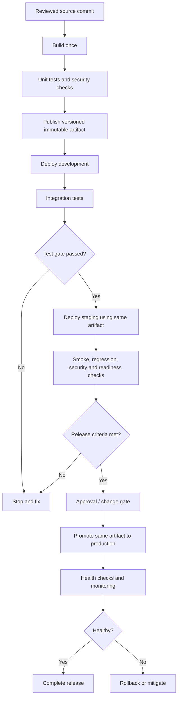

# 06 — Environment Promotion

Learn how to move a tested software release safely through development, testing, staging, and production environments while maintaining traceability, security, and rollback capability.

## Learning objectives

By completing this module, you should be able to:

- Explain environment promotion and why it matters in CI/CD.
- Distinguish build, deployment, and release.
- Design a promotion flow across development, testing, staging, and production.
- Promote the same immutable artifact between environments.
- Configure environment-specific variables, secrets, permissions, and approval gates.
- Use automated tests and health checks as promotion criteria.
- Plan rollback, database compatibility, and audit records.
- Identify common risks in environment promotion and propose mitigations.

## Prerequisites

- Basic Git and CI/CD pipeline knowledge.
- Familiarity with artifacts, registries, and deployment concepts.
- A test repository for optional GitHub Actions exercises.
- A non-production application and environment for deployment practice.

## What is environment promotion?

Environment promotion is the controlled process of advancing a particular software artifact from a lower-risk environment to a higher-risk environment after it meets defined validation and approval requirements.

A common path is:

1. **Development:** Rapid integration and developer testing.
2. **Test / QA:** Functional, integration, contract, and regression testing.
3. **Staging / pre-production:** Production-like validation, smoke tests, and operational checks.
4. **Production:** Release to users with monitoring and rollback readiness.

Not every organization needs four separate environments. Choose the smallest set that provides adequate isolation, confidence, and governance.

## Core concepts

| Concept | Meaning |
|---|---|
| Environment | A target context with its own infrastructure, configuration, access controls, and data policies. |
| Artifact | The package or image produced by a build. |
| Promotion | Authorizing the same artifact to move to another environment. |
| Deployment | Installing or activating an artifact in an environment. |
| Release | Making a version or capability available to users. |
| Configuration | Environment-specific settings, such as service endpoints or feature settings. |
| Secret | Sensitive value such as a token, password, or private key. |
| Approval gate | A required automated policy check or authorized human approval. |
| Smoke test | A quick check that the deployed service's essential functions work. |
| Rollback | Returning to a previous known-good version or otherwise restoring service. |

## Reference architecture



## Build once, promote many

The recommended pattern is to build an artifact once and promote that exact artifact through the environments.

```text
Commit abc123
    |
    v
Build application image/package
    |
    v
Artifact digest: sha256:<real-digest>
    |
    +--> Deploy development
    +--> Deploy test
    +--> Deploy staging
    +--> Deploy production after approval
```

The digest above is illustrative. Record the real digest generated by your registry or build process.

Rebuilding separately for each environment can introduce differences in dependencies, build tools, timestamps, or generated content. Promote the same artifact and inject environment-specific configuration securely at runtime.

## Environment design

| Environment | Purpose | Typical controls |
|---|---|---|
| Development | Fast feedback and integration | Restricted test data, basic automated checks |
| Test / QA | Functional and regression confidence | Repeatable datasets, isolated services, automated suites |
| Staging | Production-like release rehearsal | Production-like configuration, smoke tests, release checklist |
| Production | Serve real users and business workloads | Strict access, monitoring, backups, approval, rollback plan |

### Configuration and secrets

Keep environment-specific configuration separate from the artifact when possible. For example, use a different API endpoint for staging and production without rebuilding the application.

- Store secrets in a secret manager or protected CI/CD environment.
- Do not commit credentials, `.env` files, private keys, or production configuration containing secrets.
- Grant each deployment identity access only to its target environment.
- Keep non-secret settings separate from sensitive credentials.
- Rotate credentials according to organizational policy and when exposure is suspected.

## Promotion gates

A promotion gate should be explicit, measurable, and owned. Examples include:

- Required unit, integration, and regression tests pass.
- No unapproved vulnerabilities exceed the defined severity threshold.
- Artifact digest matches the tested artifact.
- Deployment configuration passes validation.
- Staging smoke tests and health checks pass.
- Required change ticket or release notes are available.
- Production approval is recorded where required.
- Monitoring and rollback readiness are confirmed.

Define exception handling, including who can approve an exception, the reason, expiry, and follow-up action. Avoid informal bypasses.

## GitHub Actions environments

GitHub Actions environments can associate deployment jobs with environment-specific secrets and variables and can enforce protection rules such as required reviewers, wait timers, and branch/tag restrictions. A job referencing a protected environment must pass the configured rules before it proceeds and receives that environment's secrets. Availability of some protection features depends on repository visibility and plan. See the official [deployments and environments documentation](https://docs.github.com/en/actions/reference/workflows-and-actions/deployments-and-environments) and [environment management guide](https://docs.github.com/en/actions/how-tos/deploy/configure-and-manage-deployments/manage-environments). <Cite refs={["turn584792search0","turn584792search1"]}/>

Use repository settings to create and configure environments such as `development`, `staging`, and `production`. Do not assume that simply referencing an environment name automatically configures its protection rules or secrets.

## Promotion strategy patterns

### Sequential promotion

Advance from development to test to staging to production, with each gate requiring success from the previous stage. This is easy to reason about.

### Automated promotion

Advance automatically when measurable policy conditions pass. Keep production protections appropriate to the service's risk.

### Approval-based promotion

Require a reviewer or change authority before production. Approval should be separate from code authorship where required by policy.

### Progressive delivery

Use canary or blue/green deployment to limit exposure and provide a controlled path to wider rollout. Promotion may be based on health metrics, error rates, latency, and business indicators.

## Rollback and database compatibility

Rollback should identify a previous known-good artifact and a tested way to restore service. It is not always as simple as redeploying old application code.

- Keep previous production artifacts available for the required retention period.
- Define health metrics and thresholds that trigger rollback or mitigation.
- Ensure configuration changes can be reverted.
- Prefer backward-compatible, expand-and-contract database migrations.
- Do not assume a database schema or data migration can be safely reversed.
- Test rollback and recovery procedures in a non-production environment.
- Preserve deployment records, artifact digests, approvals, and relevant logs.

## Common risks and mitigations

| Risk | Mitigation |
|---|---|
| Rebuilding between staging and production | Promote the same artifact by digest/version. |
| Production secrets exposed to test jobs | Use environment-scoped secrets and separate identities. |
| Unreviewed production deployment | Configure protected environments and required approvals. |
| Staging differs significantly from production | Use production-like configuration and infrastructure where feasible. |
| Artifact tag is mutable | Record and verify immutable digest or enforce tag immutability. |
| Rollback artifact is deleted | Retain supported release artifacts and test recovery. |
| Deployment overlaps another deployment | Use environment concurrency or deployment locking. |
| Health checks are absent | Define readiness, smoke tests, and monitoring before release. |

## Suggested directory structure

```text
06-Environment-Promotion/
├── README.md
├── examples.md
├── practical.md
└── solutions.md
```

## Knowledge check

1. What is the difference between a deployment and a release?
2. Why should the same artifact be promoted across environments?
3. Which settings should differ between staging and production?
4. What should a production promotion gate verify?
5. Why are artifact digests useful?
6. What makes rollback more complicated after a database migration?

## Further reading

- [GitHub Actions: Deployments and environments](https://docs.github.com/en/actions/reference/workflows-and-actions/deployments-and-environments)
- [GitHub Actions: Manage deployment environments](https://docs.github.com/en/actions/how-tos/deploy/configure-and-manage-deployments/manage-environments)
- [GitHub Actions: Control deployments](https://docs.github.com/en/actions/how-tos/deploy/configure-and-manage-deployments/control-deployments)
- [Google SRE — Release Engineering](https://sre.google/sre-book/release-engineering/)
- [OWASP DevSecOps Guideline](https://owasp.org/www-project-devsecops-guideline/)

## Completion checklist

- [ ] I can draw an environment promotion flow.
- [ ] I can explain build-once, promote-many.
- [ ] I can separate configuration and secrets from artifacts.
- [ ] I can define automated and manual promotion gates.
- [ ] I can explain artifact identity, approvals, and audit records.
- [ ] I have documented rollback and database compatibility concerns.
