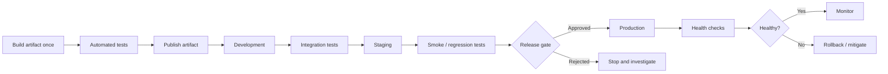

# Examples — Environment Promotion

These examples are educational templates. Use a test repository and non-production environments. Replace placeholder deployment commands with commands for your actual platform.

## Example 1 — Promotion flow



## Example 2 — Promotion policy checklist

Before promoting to production, verify:

```text
PROMOTION_ALLOWED =
    required_tests_passed
    AND security_policy_passed
    AND artifact_digest_matches_tested_digest
    AND staging_smoke_tests_passed
    AND deployment_configuration_validated
    AND required_approval_recorded
    AND rollback_plan_ready
```

This is conceptual pseudocode, not a runnable policy engine. Define each condition, evidence source, owner, and exception process.

## Example 3 — GitHub Actions with staging and production environments

This sample demonstrates workflow structure and environment gates. It intentionally uses placeholder deployment commands. It does not build a real application or deploy to a real cloud platform until you replace those commands.

Save as `.github/workflows/promote.yml`:

```yaml
name: Environment Promotion

on:
  workflow_dispatch:

permissions:
  contents: read

concurrency:
  group: environment-promotion
  cancel-in-progress: false

jobs:
  validate:
    name: Validate source
    runs-on: ubuntu-latest
    steps:
      - name: Check out source
        uses: actions/checkout@v4

      - name: Basic validation
        run: |
          test -f README.md
          git diff --check

  staging:
    name: Deploy to staging
    needs: validate
    runs-on: ubuntu-latest
    environment: staging
    steps:
      - name: Staging deployment placeholder
        run: |
          echo "Replace with your approved staging deployment command."
          echo "Do not print secrets or tokens in workflow logs."

      - name: Staging smoke-test placeholder
        run: |
          echo "Replace with a real health check or smoke-test command."
          # Example after defining a non-secret URL:
          # curl --fail --silent --show-error "$STAGING_URL/health"

  production:
    name: Deploy to production
    needs: staging
    runs-on: ubuntu-latest
    environment: production
    steps:
      - name: Production deployment placeholder
        run: |
          echo "Replace with deployment of the exact artifact validated in staging."
```

Configure `staging` and `production` under **Repository Settings → Environments**. Add suitable environment protection rules and secrets there. A job that references a configured protected environment must satisfy its rules before proceeding. The workflow alone does not create the desired approval policy. See [GitHub's environment documentation](https://docs.github.com/en/actions/reference/workflows-and-actions/deployments-and-environments).

**Important limitations:**

- The workflow above is a structure example; its echo commands do not deploy an application.
- A real workflow should build and publish an artifact, then pass an immutable artifact version or digest to both deployment jobs.
- In production, pin third-party actions to verified full commit SHAs and review permissions.
- Add test and security gates appropriate to the application.

## Example 4 — Separate build from promotion

Recommended design:

```text
CI workflow
  1. Checkout reviewed commit
  2. Build package/image once
  3. Run tests and security checks
  4. Publish artifact
  5. Record artifact digest

Promotion workflow
  1. Select approved artifact digest
  2. Deploy digest to staging
  3. Run smoke and regression tests
  4. Wait for required production approval
  5. Deploy the same digest to production
  6. Verify health and record release
```

Avoid rebuilding the application inside the production job. Environment-specific configuration should be provided separately and securely.

## Example 5 — Environment configuration matrix

| Setting | Development | Staging | Production |
|---|---|---|---|
| Service URL | Dev endpoint | Staging endpoint | Production endpoint |
| Database | Isolated dev DB | Staging DB with approved test data | Production DB |
| Credentials | Dev-only identity | Staging-only identity | Production-only identity |
| Debug mode | May be enabled locally | Disabled | Disabled |
| Approval | Usually automated | Team or policy gate | Required approval when risk/policy calls for it |
| Monitoring | Developer logs | Release readiness checks | Production alerts and dashboards |

Do not use production credentials or sensitive production data in lower environments unless explicitly approved and protected by policy.

## Example 6 — Record the artifact identity

For a container image, record the registry digest produced by the registry. A deployment record could contain:

```yaml
release:
  application: sample-api
  source_commit: "<commit-sha>"
  artifact: "registry.example.com/team/sample-api"
  digest: "sha256:<actual-digest>"
  tested_in:
    - development
    - staging
  approved_by: "<reviewer-or-system-id>"
  change_reference: "<change-ticket-if-used>"
```

All values in angle brackets are placeholders. This is an illustrative YAML record, not a secret store. Do not put credentials in release metadata.

## Example 7 — Verify a health endpoint

If the service exposes a non-secret health endpoint:

```bash
curl --fail --silent --show-error https://staging.example.com/health
```

PowerShell:

```powershell
Invoke-WebRequest -Uri "https://staging.example.com/health" -UseBasicParsing
```

Replace the example host with an authorized test service. A single HTTP response may not be enough to establish readiness; production systems may need dependency checks, latency thresholds, and error-rate monitoring.

## Example 8 — Promotion and rollback decision table

| Condition | Action |
|---|---|
| Unit tests fail | Block build/promotion. |
| Security gate fails | Block promotion according to policy; investigate or use approved exception process. |
| Staging smoke test fails | Stop; do not promote to production. |
| Artifact digest differs from approved digest | Reject deployment and investigate integrity or workflow error. |
| Production approval is pending | Wait; do not bypass the configured gate. |
| Production health degrades after deployment | Pause rollout and follow tested rollback/mitigation procedure. |
| Rollback artifact unavailable | Escalate; restore artifact availability and follow incident procedure. |

## Example 9 — Sequential vs. parallel validation

Independent validation checks can run in parallel. Environment promotion should still wait for all required checks.

```text
             +--> Unit tests -----+
Commit ------+--> Secret scan ----+--> Gate --> Build/publish --> Staging
             +--> Static analysis-+                           |
                                                               v
                                                         Smoke tests
                                                               |
                                                               v
                                                        Approval gate
                                                               |
                                                               v
                                                          Production
```

The best pipeline balances feedback speed, runner capacity, and the risk of a failed release.
