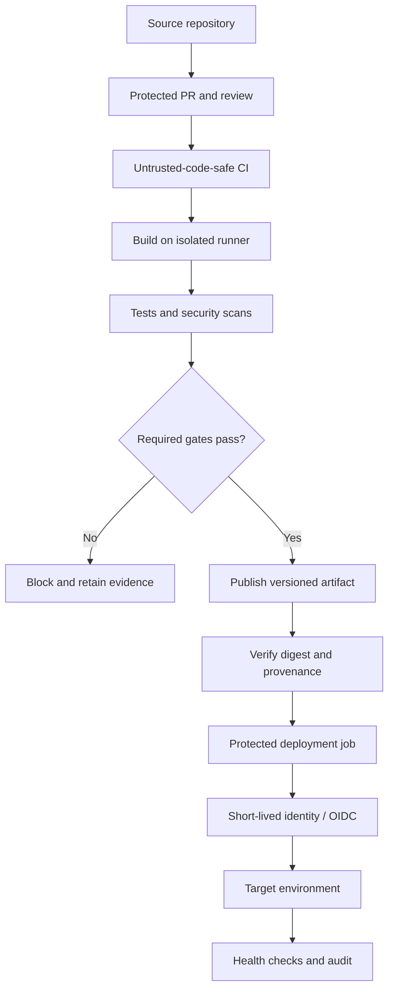

# 08 — Pipeline Security

Learn to protect CI/CD workflows, runners, credentials, dependencies, artifacts, and deployment permissions from tampering, secret exposure, and supply-chain attacks.

## Learning objectives

- Identify CI/CD attack surfaces and trust boundaries.
- Apply least privilege to workflow and job permissions.
- Protect secrets and use short-lived credentials where possible.
- Secure pull-request workflows and avoid executing untrusted code in privileged contexts.
- Pin and review third-party actions and reusable workflows.
- Harden runners, caches, artifacts, and deployment environments.
- Add security checks to pipeline configuration and respond to suspected compromise.

## Why pipeline security matters

CI/CD systems may access source code, package registries, cloud identities, signing keys, release artifacts, and production environments. A compromised pipeline can steal credentials, alter source, poison artifacts, or publish a malicious release. The automation system itself must be protected—not only the application being built.

## Core concepts

| Concept | Meaning |
|---|---|
| Trust boundary | Point where data, identity, or code crosses between different trust levels. |
| Least privilege | Give each workflow/job only the permissions it requires. |
| Runner | Machine or execution environment that runs pipeline jobs. |
| Untrusted contribution | Code or metadata from a source not controlled by the workflow owner. |
| OIDC federation | Exchange of a job identity token for short-lived credentials. |
| Artifact integrity | Confidence that deployed content is the expected content. |
| Provenance | Evidence describing where and how an artifact was built. |
| Policy gate | Rule that blocks an action when a security requirement is not met. |

## Reference architecture



## Major attack surfaces and controls

### Workflow permissions
- Set restrictive workflow-level permissions, such as `contents: read`.
- Grant extra permissions only to jobs that need them.
- Avoid `write-all` and unnecessary package, issue, pull-request, or deployment permissions.
- Review repository and organization Actions settings.

### Untrusted pull requests
- Use `pull_request` for ordinary validation of fork contributions.
- Do not combine privileged `pull_request_target` workflows with checkout or execution of untrusted PR code.
- Separate untrusted validation from privileged publishing and deployment.
- Treat artifacts from untrusted workflows as untrusted input until verified.

### Third-party actions
- Pin actions and reusable workflows to verified full commit SHAs, or use an enforced workflow dependency lockfile where supported.
- Review action source and maintainer trust.
- Use allowlists where appropriate and keep dependencies updated through controlled review.
- Remember: pinning reduces mutable-reference risk but does not eliminate vulnerabilities in the pinned code.

### Secrets and cloud credentials
- Never hard-code secrets or commit `.env` files and private keys.
- Scope secrets to the smallest repository, job, and environment possible.
- Prefer short-lived credentials and OIDC federation where supported.
- Restrict which branches, workflows, and environments can request credentials.
- Never print tokens or dump all environment variables into logs.
- Revoke/rotate exposed credentials and investigate their use.

### Runner compromise
- Prefer ephemeral, isolated runners for sensitive workloads.
- Do not run untrusted PRs on privileged persistent self-hosted runners.
- Separate runner groups by trust level and target environment.
- Patch runner images, minimize installed tools, and restrict network egress where practical.
- Avoid cross-job reuse of sensitive state.

### Cache and artifact poisoning
- Scope caches to appropriate trust boundaries.
- Do not let privileged workflows restore caches writable by untrusted jobs.
- Bind artifacts to workflow run, source commit, and digest.
- Verify artifact origin and content before deployment.
- Use immutable release identifiers, provenance, and signatures where supported.

### Workflow expression injection

Unsafe pattern:

```yaml
- name: Unsafe
  run: echo "${{ github.event.pull_request.title }}"
```

Safer pattern:

```yaml
- name: Treat event data as text
  env:
    PR_TITLE: ${{ github.event.pull_request.title }}
  run: |
    printf '%s\n' "$PR_TITLE"
```

Treat the value as untrusted even when passed through an environment variable. Do not evaluate it as code; validate it if used in commands, paths, or queries.

## Security controls by phase

| Phase | Controls |
|---|---|
| Repository | Protected branches, CODEOWNERS, required reviews, secret scanning |
| Trigger | Restrict privileged triggers and review fork behavior |
| Workflow | Least privilege, safe expression handling, reviewed workflow changes |
| Runner | Isolation, patching, restricted egress, no unsafe cross-job state |
| Dependencies | Lockfiles, verified sources, action pinning, dependency scanning |
| Build/test | Isolated execution; no production secrets in PR jobs |
| Artifact | Digest, SBOM, provenance, signing where supported, immutable release policy |
| Deployment | Protected environments, separate deploy identity, OIDC, approvals |
| Operations | Audit logs, alerts, incident response, credential rotation |

## Least-privilege example

```yaml
name: Secure CI Example

on:
  pull_request:
  push:
    branches: [main]

permissions:
  contents: read

jobs:
  validate:
    runs-on: ubuntu-latest
    steps:
      - name: Check out source
        uses: actions/checkout@v4
      - name: Validate repository
        run: git diff --check
```

This is a learning example. For production, pin actions to verified full commit SHAs or use a supported enforced dependency lockfile. Add only permissions required by a specific job.

## OIDC and short-lived credentials

OIDC can reduce reliance on long-lived cloud keys stored as CI secrets. Grant `id-token: write` only to the job that needs the token, and configure the cloud trust policy to restrict the intended repository, branch, environment, and audience. OIDC alone does not make a broad trust policy safe.

GitHub's default OIDC subject claim format has evolved for some repositories created after July 15, 2026. Confirm the actual claims and update provider trust policies accordingly.

## Incident response for suspected pipeline compromise

1. Pause affected workflows and release processes.
2. Revoke or rotate exposed credentials and tokens.
3. Identify affected runs, repositories, artifacts, and environments.
4. Preserve audit logs, workflow diffs, runner evidence, and relevant network activity.
5. Quarantine artifacts whose integrity cannot be established.
6. Rebuild from a known-good source and trusted toolchain.
7. Verify artifact digest and provenance before redeployment.
8. Restore service using a known-good release if needed.
9. Document scope, root cause, containment, recovery, and follow-up controls.

## Suggested directory structure

```text
08-Pipeline-Security/
├── README.md
├── examples.md
├── practical.md
└── solutions.md
```

## Knowledge check

1. Why is `write-all` risky?
2. Why should privileged `pull_request_target` workflows not execute untrusted PR code?
3. What risk is reduced by pinning an action to a full commit SHA?
4. How does OIDC help with credential management?
5. Why can persistent self-hosted runners be dangerous?
6. How can caches and artifacts cross trust boundaries?
7. What should happen first after a pipeline secret leak?

## Further reading

- [GitHub Actions secure use reference](https://docs.github.com/en/actions/reference/security/secure-use)
- [GitHub Actions OIDC reference](https://docs.github.com/en/actions/reference/security/oidc)
- [OWASP DevSecOps Guideline — Repository Hardening](https://owasp.github.io/DevSecOpsGuideline/2-Process/2-2-Develop/2-2-1-Pre-commit/2-2-1-4-Repository-Hardening/)
- [SLSA](https://slsa.dev/)
- [OpenSSF Scorecard](https://scorecard.dev/)

## Completion checklist

- [ ] I can identify pipeline trust boundaries.
- [ ] I can configure least-privilege workflow permissions.
- [ ] I understand untrusted PR and expression-injection risks.
- [ ] I can explain action pinning, runner isolation, and artifact integrity.
- [ ] I can explain OIDC trust restrictions.
- [ ] I have completed the exercises and an incident response plan.
