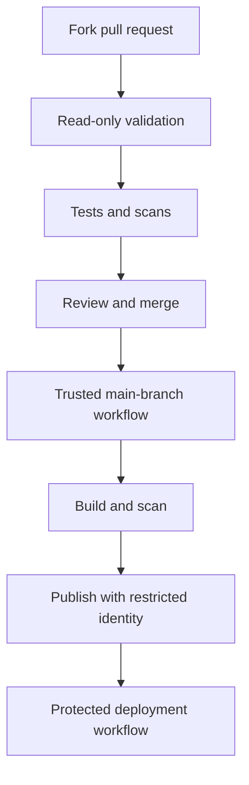

# Examples — Pipeline Security

Use these examples in a test repository. The `@v4` references are convenient for learning; for production, pin actions to verified full commit SHAs or use an enforced workflow dependency lockfile where supported.

## Example 1 — Minimal read-only CI

```yaml
name: Secure CI

on:
  pull_request:
  push:
    branches: [main]

permissions:
  contents: read

jobs:
  validate:
    runs-on: ubuntu-latest
    steps:
      - name: Check out source
        uses: actions/checkout@v4
      - name: Basic validation
        run: git diff --check
```

It explicitly uses read-only repository access, does not request deployment credentials, and does not deploy from pull requests.

## Example 2 — Job-level permissions

```yaml
name: Job Permissions Example

on:
  push:
    branches: [main]

permissions:
  contents: read

jobs:
  validate:
    runs-on: ubuntu-latest
    permissions:
      contents: read
    steps:
      - uses: actions/checkout@v4
      - run: git diff --check

  publish:
    needs: validate
    runs-on: ubuntu-latest
    permissions:
      contents: read
      packages: write
    steps:
      - name: Publishing placeholder
        run: echo "Add approved package publishing commands here."
```

The publishing job receives package-write permission because that is its purpose. Replace the placeholder only after configuring a real registry and reviewing required permissions.

## Example 3 — Avoid direct shell interpolation

Unsafe:

```yaml
- name: Unsafe event data handling
  run: echo "${{ github.event.pull_request.title }}"
```

Safer:

```yaml
- name: Treat title as data
  env:
    PR_TITLE: ${{ github.event.pull_request.title }}
  run: |
    printf 'Pull request title: %s\n' "$PR_TITLE"
```

This avoids substituting the title into the shell program source. The value remains untrusted; do not evaluate it as code and validate it before using it in commands or paths.

## Example 4 — Separate untrusted validation from publishing



Do not combine a privileged `pull_request_target` trigger with checkout or execution of untrusted PR code. If a privileged workflow consumes artifacts from another workflow, verify their origin and contents.

## Example 5 — OIDC permission pattern

```yaml
jobs:
  deploy:
    runs-on: ubuntu-latest
    permissions:
      contents: read
      id-token: write
    steps:
      - uses: actions/checkout@v4
      - name: Cloud authentication placeholder
        run: echo "Configure the cloud provider's official OIDC login action here."
```

This does not configure a cloud provider by itself. Restrict the provider trust policy by repository, branch/environment, audience, and relevant claims. `id-token: write` enables token retrieval; it does not grant cloud-resource permissions by itself.

## Example 6 — Use a secret without printing it

```yaml
jobs:
  deploy:
    runs-on: ubuntu-latest
    environment: staging
    permissions:
      contents: read
    steps:
      - name: Use a staging token
        env:
          DEPLOY_TOKEN: ${{ secrets.STAGING_DEPLOY_TOKEN }}
        run: |
          test -n "$DEPLOY_TOKEN"
          ./scripts/deploy-staging.sh
```

This assumes the deployment script is trusted and uses the token securely. Do not print the token, enable shell tracing around sensitive operations, or upload it as an artifact. Prefer short-lived credentials where supported.

## Example 7 — Workflow security review checklist

Review `.github/workflows/` for:

- `permissions: write-all`
- Unnecessary write permissions
- `pull_request_target` with untrusted checkout or execution
- Direct event-data interpolation into `run:` scripts
- Third-party actions referenced by mutable tags/branches
- Production secrets available to PR validation
- Persistent self-hosted runners used by untrusted jobs
- Artifact downloads without origin/content verification
- Cache reuse across trust levels
- Secrets printed in logs
- Deployment jobs lacking protection or audit evidence

Automated linters and code scanning help, but review the workflow's trust model too.

## Example 8 — Threat model

| Asset | Threat | Control |
|---|---|---|
| Repository token | Malicious action modifies source/releases | Least privilege, pinning, review |
| Cloud credential | Secret exfiltration from build | OIDC, restricted trust, no PR secrets |
| Self-hosted runner | Persistence between jobs | Ephemeral runners, isolation, patching |
| Build artifact | Artifact substitution | Digest verification, provenance, restricted publishing |
| Workflow configuration | Unauthorized deployment | Branch protection, CODEOWNERS, approvals |
| Cache | Poisoned build inputs | Scope keys and permissions to trust level |

## Example 9 — Incident response checklist

```text
[ ] Pause affected workflows and deployments
[ ] Revoke/rotate exposed credentials
[ ] Identify affected runs, actions, runners, artifacts, environments
[ ] Preserve audit logs and relevant evidence
[ ] Quarantine suspicious artifacts
[ ] Rebuild from a known-good commit and trusted toolchain
[ ] Verify digest and provenance
[ ] Restore service using a known-good release
[ ] Document root cause and follow-up actions
```
